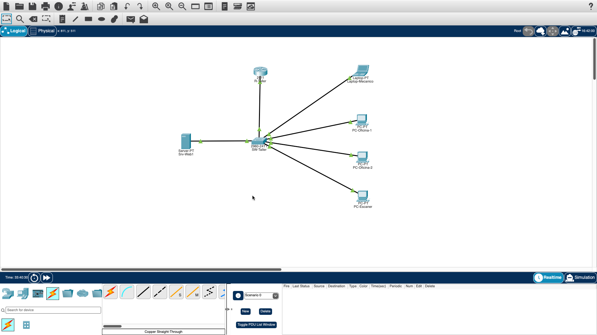

# Red para un taller automotriz

Diseñé y simulé en Cisco Packet Tracer la red de un taller pequeño. La idea es sencilla: que la oficina y el área de servicio tengan cada una su propio espacio, que los equipos reciban su dirección solos y que todos puedan consultar una página interna del taller.

## ¿Qué problema resuelve?

En muchos talleres pequeños todos los equipos están conectados en una sola red mezclada. Eso causa tres cosas:

- **Desorden:** la computadora de cotizaciones y el escáner de diagnóstico se ven entre sí, y es difícil encontrar fallas.
- **Trabajo manual:** a cada equipo se le pone su dirección a mano, y a veces dos equipos terminan con la misma.
- **Sin información compartida:** no hay un lugar interno donde ver el catálogo de servicios o los avisos.

## ¿Cómo lo resolví?

Lo expliqué en cinco pasos:

1. **Separé la red en dos áreas** (Oficina y Servicio) usando VLAN. Es como poner una pared entre dos cuartos que comparten el mismo pasillo.
2. **Conecté las dos áreas con un router.** Es la puerta que permite pasar de un cuarto al otro cuando hace falta.
3. **Hice que cada equipo reciba su dirección solo** con DHCP, sin escribirla a mano.
4. **Puse un servidor web interno** con el catálogo de servicios y avisos, que se abre desde cualquiera de las dos áreas.
5. **Probé todo y dejé las pruebas documentadas.**

## ¿Cómo quedó?



| Área | Equipos | Red | Puerta de salida |
|---|---|---|---|
| Oficina (VLAN 10) | 2 PC y el servidor web | 192.168.10.0/24 | 192.168.10.1 |
| Servicio (VLAN 20) | PC del escáner y laptop del mecánico | 192.168.20.0/24 | 192.168.20.1 |

- Un switch conecta todos los equipos y un router comunica las dos áreas.
- Los equipos reciben su dirección automática a partir de la .11 en cada red.
- Las primeras 10 direcciones de cada red quedan reservadas para equipos fijos, como el servidor (192.168.10.10).
- Puse el servidor en la red de Oficina porque, con solo dos áreas, es el lugar más simple. Servicio llega a él pasando por el router, y así queda probado que la comunicación entre áreas funciona.

## ¿Funciona? Esto probé

| Prueba | Resultado | Evidencia |
|---|---|---|
| Cada equipo está en su área | Oficina en la VLAN 10 y Servicio en la VLAN 20 | [Captura](screenshots/02-vlan-brief.png) |
| El cable switch-router lleva las dos áreas | Enlace activo con las VLAN 10 y 20 | [Captura](screenshots/03-trunk.png) |
| Los equipos reciben dirección solos | 4 equipos con dirección automática, cada uno en su red | [Captura](screenshots/05-dhcp-binding.png) |
| Servicio llega al servidor de Oficina | 4 de 4 respuestas, sin pérdida | [Captura](screenshots/08-ping-intervlan.png) |
| La página abre desde Oficina | Cargó correctamente | [Captura](screenshots/09-web-oficina.png) |
| La página abre desde Servicio | Cargó correctamente | [Captura](screenshots/10-web-servicio.png) |
| **Prueba de falla:** apagué el enlace del router | Servicio dejó de llegar al servidor (100% de pérdida) | [Captura](screenshots/12-ping-enlace-caido.png) |
| **Recuperación:** volví a encenderlo | El servidor respondió de nuevo. El primer intento perdió 2 de 4 paquetes mientras la red se acomodaba | [Captura](screenshots/13-ping-restaurado.png) |

La prueba de falla muestra algo importante: sin el router, las dos áreas quedan separadas.

## Archivos

- [Configuración del switch](config/sw-taller-running-config.txt)
- [Configuración del router](config/r-taller-running-config.txt)
- [Archivo de Packet Tracer](taller-red-segmentada.pkt)

<details>
<summary>Cómo replicarlo (comandos)</summary>

1. En Packet Tracer coloca un router 2911, un switch 2960, 3 PC, 1 laptop y 1 servidor.
2. Conecta con cable directo: PC-Oficina-1 a Fa0/1, PC-Oficina-2 a Fa0/2, servidor a Fa0/3, PC-Escaner a Fa0/11, laptop a Fa0/12 y router (Gi0/0) a Gi0/1 del switch.
3. En la CLI del switch pega:

```
enable
configure terminal
hostname SW-Taller
vlan 10
 name Oficina
vlan 20
 name Servicio
interface range fastEthernet 0/1-3
 switchport mode access
 switchport access vlan 10
interface range fastEthernet 0/11-12
 switchport mode access
 switchport access vlan 20
interface gigabitEthernet 0/1
 switchport mode trunk
end
write memory
```

4. En la CLI del router pega:

```
enable
configure terminal
hostname R-Taller
interface gigabitEthernet 0/0
 no shutdown
interface gigabitEthernet 0/0.10
 encapsulation dot1Q 10
 ip address 192.168.10.1 255.255.255.0
interface gigabitEthernet 0/0.20
 encapsulation dot1Q 20
 ip address 192.168.20.1 255.255.255.0
ip dhcp excluded-address 192.168.10.1 192.168.10.10
ip dhcp excluded-address 192.168.20.1 192.168.20.10
ip dhcp pool OFICINA
 network 192.168.10.0 255.255.255.0
 default-router 192.168.10.1
ip dhcp pool SERVICIO
 network 192.168.20.0 255.255.255.0
 default-router 192.168.20.1
end
write memory
```

5. En el servidor usa IP fija 192.168.10.10, máscara 255.255.255.0 y gateway 192.168.10.1, y deja el servicio HTTP encendido con una página sencilla.
6. En las PC y la laptop selecciona DHCP.

</details>

## Limitaciones y mejoras

Es una simulación, no una red física. Para llevarla a un taller real, lo siguiente sería:

- Limitar con reglas (ACL) qué puede alcanzar cada área.
- Agregar una red separada para administrar los equipos.
- Proteger los accesos con contraseñas.
- Añadir un segundo enlace para que no dependa de un solo cable.

## Autor

Rogelio Saldaña Colorado
